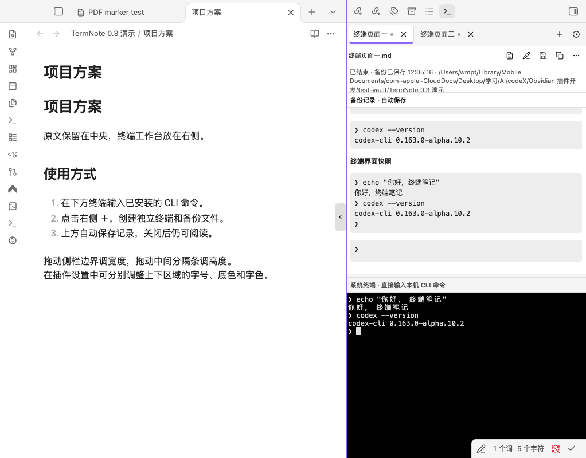

# TermNote

TermNote is a desktop Obsidian plugin that embeds an interactive terminal in a tabbed workspace. Every terminal tab belongs to a real Markdown note. Commands and displayed output are continuously saved, so the note remains readable, searchable and shareable after the terminal closes or the plugin is removed.

## Features

- Run your installed command line agents or a system shell, with custom executable paths, arguments and working directories.
- Open multiple independent tabs. New tabs create incrementally named notes in the same folder; renaming a note updates its tab.
- Save raw terminal output before updating the readable Markdown record. Existing user text outside the managed record is preserved.
- Resume a specific OpenCode session by its native ID. OpenCode integration archives user messages, assistant answers and tool results without duplicating messages on refresh.
- Choose among OpenCode, Codex, Claude Code and custom launch profiles. Agent programs and model accounts are not included.

## Requirements and installation

Use Obsidian **1.14.4 or later on macOS or Windows**. Mobile devices are not supported. Install **Python 3.9 or later**. Windows also needs `pywinpty`, installed into the same interpreter with `python -m pip install pywinpty`. Install and authenticate your chosen agent separately.

While community review is pending, install with [BRAT](https://github.com/TfTHacker/obsidian42-brat) by adding `ptwm-git/termnote`, or download the ZIP from [GitHub Releases](https://github.com/ptwm-git/termnote/releases/latest). Extract its `agent-note-terminal` folder into your vault's `.obsidian/plugins/` and enable **TermNote**. The runtime consists of the standard `main.js`, `manifest.json` and `styles.css` files; the Python bridge is embedded in the bundle.

Open a Markdown note and run **TermNote: 在当前笔记打开终端** from the command palette, or click the terminal ribbon icon. A fresh installation defaults to OpenCode. Use its native account/model setup before chatting. In Settings → TermNote, use the environment check and configure your agent profiles. Use the **+** button for a new independent conversation. Closing a terminal tab hides it while recording continues; use the stop button to end its process.

The interface currently uses Chinese labels. The detailed Chinese guide below explains all controls. [Release status](docs/RELEASE.md) and [validation results](docs/VALIDATION.md) distinguish tested behavior from remaining limits. macOS Obsidian and actual OpenCode conversations have been exercised; Windows ConPTY and real OpenCode protocol tests pass in CI, while the Windows Obsidian graphical interface still needs manual testing.

## Local access, network and stored records

This plugin launches local programs with your user permissions. Those programs can execute commands and read or write files, including working directories outside the vault. OpenCode integration creates an authenticated service bound only to `127.0.0.1`. The plugin does not install dependencies, collect telemetry or read agent authentication files. The chosen agent manages model connections, credentials and any provider charges.

Conversations and displayed tool results are stored as **plain text** in your vault. Review the actual contents before sharing. Raw logs live in `.agent-note-terminal/`; keep those logs and the plugin's data together with the notes for recovery. Do not run the same session on two computers concurrently. Generic terminal mode records visible output and does not promise accurate role classification or native context resume for every agent. A power loss can lose data that had not reached disk.

---

# TermNote · 终端笔记

Obsidian 桌面插件：多标签终端，每个标签绑定一篇真实 Markdown 笔记，自动持续保存终端显示的文字。

0.2.0 使用新名称 TermNote · 终端笔记；0.1.0 测试包显示原名 Agent Note Terminal。插件 ID 及数据路径继续使用 `agent-note-terminal`，已有笔记无需因更名迁移。

## 环境

- Obsidian 桌面端 1.14.4+（按实际验收版本设定）。仅支持 macOS 和 Windows，不支持移动端。
- macOS：Python 3.9+；无需额外 Python 库。
- Windows 10 1809+ / Windows 11：Python 3.9+，在同一个 Python 环境运行 `python -m pip install pywinpty`。原生 ConPTY 后端、中文/Emoji、尺寸、持久化和进程清理已在真实 Windows CI 中通过；Windows 的 Obsidian 图形界面仍待人工试用。
- 自己安装并登录需要使用的 Agent。插件不附带模型、Agent 或账户，不自动安装依赖。

## 安装与开始

社区目录审核通过前，可先在 [BRAT](https://github.com/TfTHacker/obsidian42-brat) 添加仓库 `ptwm-git/termnote` 安装和更新；也可下载 GitHub Release 的 ZIP 手动安装。测试通过范围及剩余限制见 [验证记录](docs/VALIDATION.md)。

[下载安装包](https://github.com/ptwm-git/termnote/releases/latest) · [发布状态](docs/RELEASE.md)

1. 解压测试包，把 `agent-note-terminal` 文件夹放进知识库的 `.obsidian/plugins/`。
2. 0.2.0 运行只需 `manifest.json`、`main.js`、`styles.css` 三个标准文件。Python 桥接源码已内嵌 main.js，不需要额外下载脚本；0.1.0 旧包仍需原来的 bridge.py。
3. 在 Obsidian 设置 → 第三方插件中启用 **TermNote**。
4. 在插件设置点击“检测”；如果未找到 Python，填写其完整解释器路径后重新检测。
5. 打开一篇笔记，点击左侧终端图标，或执行“TermNote：在当前笔记打开终端”。
6. 全新安装默认启动 OpenCode；在原生界面完成账户与模型设置后即可对话。需要 Shell 时，在设置或工具栏选择「系统终端」，再输入你平时使用的命令。

程序与参数分别填写。例如程序是 `/完整路径/某个Agent`，参数填写 `[]` 或 `["--某个参数", "值"]`；有空格的路径无需自己加引号。工作目录留空时使用绑定笔记所在目录。直接填写程序名时，它须位于 Obsidian 进程可见的 PATH；从系统终端启动的 Agent 则使用该 Shell 的环境。

## Agent 设置与 OpenCode

- 设置底部可添加 OpenCode、Codex、Claude Code 或自定义预设，编辑路径、参数和工作目录；预设并不附带相应程序。支持同一 Agent 的多套配置和默认项。
- 全新安装默认使用 OpenCode，也保留系统终端预设；从旧版升级继续使用原先的配置和默认项。
- 「检测 Agent 版本」仅执行 `--version`。通用终端支持用户安装的命令行 Agent，不猜测消息角色。
- OpenCode 增强模式使用每篇笔记独有的原生会话 ID，支持「继续此 OpenCode 会话」与「从此 OpenCode 原生会话补齐记录」。2.0.26 已完成协议及 Obsidian 内原生终端验收；1.19.3 已完成实际程序协议测试。详细通过范围见验证记录，未知主版本应选择通用终端模式。
- 可选模型填写 `provider/model`（2.x）；留空使用 OpenCode 原生配置。1.x 在原生界面选择模型。登录、提供商与密钥均在 OpenCode 中设置，本插件没有统一模型账户或密钥输入框。
- 增强模式的 `--session`、`--continue`、`--server` 等会话参数由插件管理，不要在参数框重复填写。需要完全自定义命令时选择通用终端模式。
- 创建新标签时可先选 Agent；为已有会话更换配置会创建同目录新笔记。已启动会话保存配置快照，编辑或删除设置不会把旧记录切换到其他 Agent。
- 在 OpenCode 内使用 `/new` 或切换历史不会改变笔记的固定归档对象；新对话使用插件「＋」，确保一页一会话。打开历史标签只显示已有笔记与日志，继续或补齐需要明确操作。

## 多标签



- 首次调用绑定当前笔记；从书签打开笔记后也可同样调用。
- 点击“＋”，在当前标签笔记所在目录创建“终端页面一.md”“终端页面二.md”……。序号每目录独立，重名跳过，重启后继续。
- 每个标签是独立进程与记录。切换标签时其他会话继续运行和保存。
- 标签支持拖动排序。右键可重命名、打开对应笔记、收起或“结束并关闭”。
- 标签中的改名会修改实际文件名；在 Obsidian 文件列表中改名也会同步到标签。
- 标签上的 × 是收起，提示中会说明后台继续保存。停止程序请使用工具栏的方形按钮或“结束并关闭”。历史入口可重新显示已有会话。
- 正常退出 Obsidian 会结束程序；再次打开时恢复标签和文字记录，不自动执行历史命令。已结束的通用会话请用新标签开始新对话。

## 保存与恢复

终端输出先进入知识库 `.agent-note-terminal/<会话ID>.jsonl`，再由插件每约 500ms 更新笔记的会话区域。终端的有限滚动历史不会作为唯一保存来源。日志包含输出、时间、尺寸和退出事件，不额外记录原始键盘按键。

OpenCode 增强模式约每 2 秒同步已绑定原生会话；先持久化 `<会话ID>.opencode.json`，再生成用户输入、Agent 回答及可折叠工具结果。重复同步更新相同消息，不重复追加；停止时补做最后同步。同步失败保留上一次成功快照并显示「原生记录待同步」，终端日志继续归档。长时间运行的工具尚未返回的结果须等待 Agent 输出。

笔记中的会话区域由 HTML 注释标识。可以编辑区域外的正文；若修改或删除会话区域，插件会停止覆盖该区域，显示待同步状态。工具栏的“恢复记录”会先备份原笔记，再从已有日志重建。原始日志可通过“日志”按钮在系统文件管理器中定位。

发生强制退出时，重新启用插件会从完整落盘事件补写笔记；无法恢复尚未落盘的尾部。删除笔记会停止对应会话并保留原始日志，不自动重建被删除的文件。

如果原始日志丢失或中部损坏，插件保留笔记原文并停止自动重建，避免空记录覆盖唯一历史。请找回完整日志，或保留旧笔记并新建会话。不要仅同步笔记却删除其关联日志和插件数据。

## 可读记录的边界

普通 Shell 命令保留文字输出。清屏和交互式 TUI 的重绘内容保存为明确标记的文字快照，完整输出事件保留在原始日志中，可在终端视图重放。通用模式不能保证将所有未知 Agent 准确整理成“用户提问 / Agent 回答 / 工具调用”。OpenCode 增强模式依据原生数据分类，不恢复模型未公开的隐藏内容。

无需插件即可阅读已生成的 Markdown。重新安装/同步到另一台电脑时，保留笔记、`.agent-note-terminal` 原始日志和插件数据可获得完整的恢复信息。不要在两台电脑同时运行同一个会话文件。

## 本机访问与网络

本插件会启动用户配置的本机程序；这些程序以当前用户权限读写文件、执行命令，并可能访问知识库以外的工作目录。OpenCode 增强模式启动经过认证、仅监听 `127.0.0.1` 的私有服务；临时口令不写入笔记、日志或插件设置。插件本身无遥测，不自动下载安装或更新程序及依赖。

模型网络请求、提供商账户及认证由所选 Agent 管理，使用收费模型可能产生对应提供商费用。本插件不读取 Agent 的认证文件；对话、工具结果和终端显示内容以明文保存在知识库，分享笔记及日志前请按实际内容处理。

## 开发

```sh
npm install
npm run check
npm run package
node scripts/install.mjs "/测试知识库绝对路径"
```

开发检查含官方 Obsidian ESLint 规则：Obsidian 规范的 Error 阻断发行；通用静态检查按社区扫描级别列为 Warning，仍完整输出，TypeScript 严格编译继续阻断类型错误。检查器声明的旧 Obsidian 精确 peer 版本通过 npm override 对齐本项目实际使用的 Obsidian 类型版本；不降低项目 API 或运行版本。

源码职责：`main.ts` 注册插件和设置；`manager.ts` 管理文件、序号与会话；`session.ts` 桥接进程及保存队列；`writer.ts`/`note.ts` 检测笔记冲突；`transcript.ts` 解析终端控制符；`view.ts` 管理标签及终端显示；`bridge.py` 运行真正的本机终端并归档输出。

测试记录见 [docs/VALIDATION.md](docs/VALIDATION.md)。源码按 MIT 许可发布，第三方终端组件的许可见 THIRD-PARTY-NOTICES.txt，发行 main.js 也内嵌许可文本。
